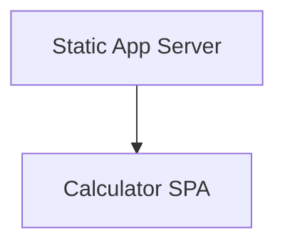
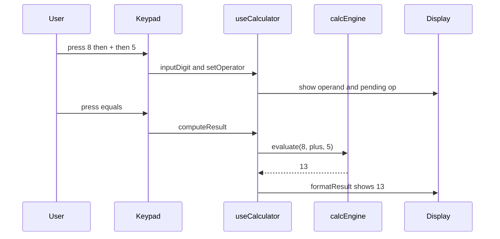
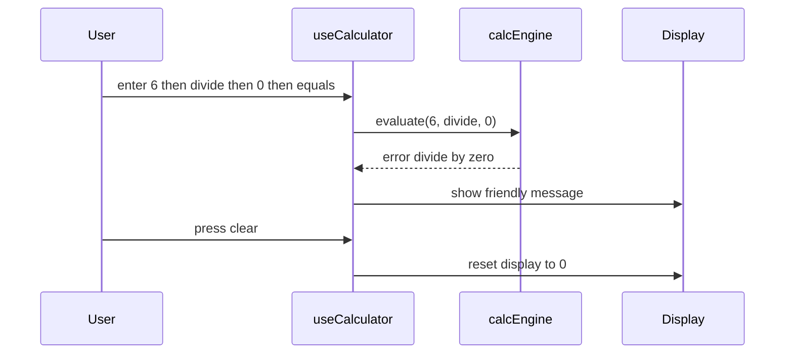
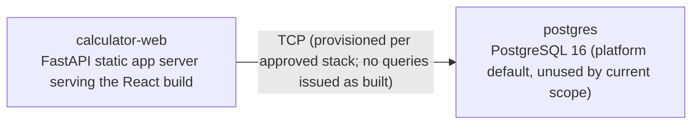

# Architecture

> Maintained by QuorQ AI SDLC. Text between `sdlc:auto` markers is regenerated; anything outside them is yours and is kept.

<!-- sdlc:auto:start narrative -->
## Overview

_No entries for this phase yet._
<!-- sdlc:auto:end narrative -->

<!-- sdlc:auto:start building-blocks -->
## Building Block View

| ID | Name | Technology | Responsibility | Depends on |
|---|---|---|---|---|
| frontend | Calculator SPA | React 19 | Renders the standard keypad on a single page, handles click/touch and physical-keyboard input, performs all four arithmetic operations in the browser, manages decimal precision, and shows friendly messages for divide-by-zero and invalid entries. Stores nothing between sessions. | — |
| backend | Static App Server | FastAPI 0.115 | Serves the built React single-page app and its static assets to the public. Does no arithmetic and holds no state; exists only as the standard way to deliver the SPA. | frontend |

<!-- sdlc:auto:end building-blocks -->

<!-- sdlc:auto:start runtime -->
## Runtime View

### Enter numbers and compute a result

User enters operands via keypad or keyboard, selects an operator, and presses equals. The React state machine builds the operand strings (handling leading zero and single decimal point), stores the pending operator, computes the result with reasonable decimal precision, and displays it. Pressing a digit after a result starts a fresh entry.

- **Components:** frontend
- **Modules:** Keypad, Display, useCalculator (state hook), calcEngine
- **Key functions:** inputDigit(d), inputDecimal(), setOperator(op), computeResult(), formatResult(value), clearAll()

### Handle divide-by-zero and invalid entries

When equals is pressed on a division by zero, an incomplete operation, or a malformed operator sequence, the engine returns a flagged error rather than throwing. The UI shows a friendly message and the app stays responsive; clear returns it to the ready state.

- **Components:** frontend
- **Modules:** useCalculator (state hook), calcEngine, Display
- **Key functions:** computeResult(), evaluate(a, op, b), showError(message), clearAll()

<!-- sdlc:auto:end runtime -->

<!-- sdlc:auto:start deployment-view -->
## Deployment View

| Name | Service | Runtime | Scaling | Environment |
|---|---|---|---|---|
| calculator-web | FastAPI static app server serving the React build | Python 3.12 + Uvicorn (FastAPI 0.115) | single small instance for dev; stateless and horizontally scalable | dev |
| postgres | PostgreSQL 16 (platform default, unused by current scope) | PostgreSQL 16 | single instance | dev |

| Source | Target | Protocol |
|---|---|---|
| calculator-web | postgres | TCP (provisioned per approved stack; no queries issued as built) |

<!-- sdlc:auto:end deployment-view -->

<!-- sdlc:auto:start decisions -->
## Architecture Decisions

| Layer | Choice | ADR |
|---|---|---|
| Frontend | React 19 | [ADR-0001](adr/frontend.md) |
| Backend | FastAPI 0.115 | [ADR-0002](adr/backend.md) |
| Database | PostgreSQL 16 | [ADR-0003](adr/database.md) |
| Cloud | AWS | [ADR-0004](adr/cloud.md) |
<!-- sdlc:auto:end decisions -->

<!-- sdlc:auto:start links -->
## Related Documents

- [Data Model](data-model.md)
- [API Specification](api/openapi.yaml)
- [Architecture Decision Records](adr/README.md)
<!-- sdlc:auto:end links -->
