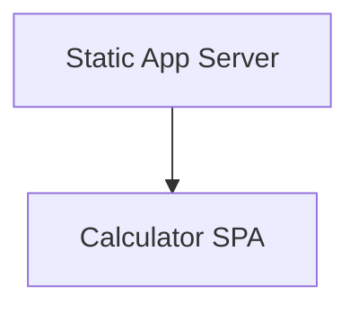
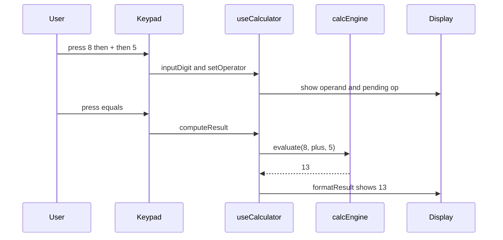
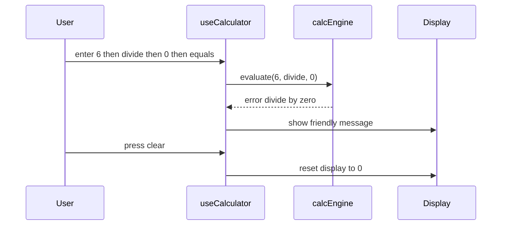
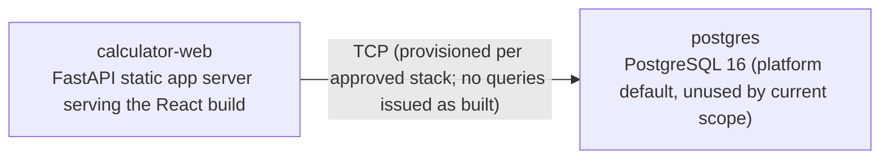

# Architecture

> Maintained by QuorQ AI SDLC. Text between `sdlc:auto` markers is regenerated; anything outside them is yours and is kept.

<!-- sdlc:auto:start narrative -->
## Overview

### ARCH-001 · approved · source: architecture:summary

Overall architecture approved as version 1: a lightweight, fully client-side arithmetic calculator with no persistence, accounts, or billing.

All calculator behaviour (keypad, digit/decimal entry, the four operations, equals, clear, divide-by-zero and invalid-entry messages, click/touch/keyboard input) lives in a React 19 single-page app that computes everything in the browser and persists nothing. A minimal FastAPI 0.115 backend exists only to serve the built SPA and its static assets -- it performs no arithmetic and stores no data. PostgreSQL 16 is named as the platform's default database but holds no calculator data as built. Deployment targets AWS to deliver the static page reliably to the public with no login, accounts, or billing.

### ARCH-002 · approved · source: architecture:component:frontend

Calculator SPA (React 19) is the component that implements every user-facing behavior of the calculator.

Renders the standard keypad on a single page; handles click/touch and physical-keyboard input; performs all four arithmetic operations in the browser; manages decimal precision; shows friendly messages for divide-by-zero and invalid entries. Stores nothing between sessions.

### ARCH-003 · approved · source: architecture:component:backend

Static App Server (FastAPI 0.115) exists solely to deliver the built SPA and its assets to the public.

Serves the built React single-page app and its static assets to the public. Does no arithmetic and holds no state; exists only as the standard way to deliver the SPA.

### ARCH-004 · approved · source: architecture:critical_path:compute-result

Critical path for entering operands and computing a result via the React state machine.

User enters operands via keypad or keyboard, selects an operator, and presses equals. The React state machine builds the operand strings (handling leading zero and single decimal point), stores the pending operator, computes the result with reasonable decimal precision, and displays it. Pressing a digit after a result starts a fresh entry.

### ARCH-005 · approved · source: architecture:critical_path:divide-by-zero-invalid-entry

Critical path for handling divide-by-zero and invalid/malformed entries without crashing.

When equals is pressed on a division by zero, an incomplete operation, or a malformed operator sequence, the engine returns a flagged error rather than throwing. The UI shows a friendly message and the app stays responsive; clear returns it to the ready state.

**Related:** ARCH-004

### ARCH-006 · approved · source: architecture:endpoints

Three HTTP endpoints exposed by the static app server; none perform calculator logic.

GET / -- serves the calculator single-page app shell (index.html). GET /assets/{file} -- serves the SPA's static JS/CSS/asset bundles. GET /health -- liveness check for the static server.

**Related:** ARCH-003

### ARCH-007 · approved · source: architecture:deployment_nodes

Two deployment nodes defined: the static web server running the SPA, and a currently-unused PostgreSQL instance.

calculator-web: FastAPI static app server serving the React build, running on Python 3.12 + Uvicorn (FastAPI 0.115). postgres: PostgreSQL 16, noted explicitly as the platform default and unused by the current scope.

**Related:** ARCH-003

### ARCH-008 · approved · source: architecture:tech_decision:frontend

Frontend technology chosen: React 19, over Vue, Svelte, or Vanilla JS.

All product behaviour lives here: the keypad, click/touch and physical-keyboard input, the four operations, decimal handling, and the friendly error messages. React's component model and keyboard-event handling fit a fixed calculator interface that redraws instantly as the user types.

**Related:** ARCH-002

### ARCH-009 · approved · source: architecture:tech_decision:backend

Backend technology chosen: FastAPI 0.115, over nginx static hosting or a Node/Express static server.

Serves the single-page app and its static files. It is lightweight, starts fast, and adds almost nothing to run since there is no server-side arithmetic or storage.

**Related:** ARCH-003

### ARCH-010 · approved · source: architecture:tech_decision:database

Database technology chosen: PostgreSQL 16, over SQLite or no database, though unused as built.

Named per the approved stack as the platform default should a stored feature ever be added. As built there is no history, no accounts, and nothing persists, so it holds no calculator data.

**Related:** ARCH-007

### ARCH-011 · approved · source: architecture:tech_decision:cloud

Cloud platform chosen: AWS, over Vercel, Netlify, or Cloudflare Pages.

Because the whole calculator runs in the visitor's browser, hosting only needs to deliver a static page quickly and reliably to the general public, which AWS does comfortably at any expected traffic level, and it is the platform's standard deployment target.

**Related:** ARCH-007
<!-- sdlc:auto:end narrative -->

<!-- sdlc:auto:start building-blocks -->
## Building Block View

| ID | Name | Technology | Responsibility | Depends on |
|---|---|---|---|---|
| frontend | Calculator SPA | React 19 | Renders the standard keypad on a single page, handles click/touch and physical-keyboard input, performs all four arithmetic operations in the browser, manages decimal precision, and shows friendly messages for divide-by-zero and invalid entries. Stores nothing between sessions. | — |
| backend | Static App Server | FastAPI 0.115 | Serves the built React single-page app and its static assets to the public. Does no arithmetic and holds no state; exists only as the standard way to deliver the SPA. | frontend |

<!-- sdlc:auto:end building-blocks -->

<!-- sdlc:auto:start runtime -->
## Runtime View

### Enter numbers and compute a result

User enters operands via keypad or keyboard, selects an operator, and presses equals. The React state machine builds the operand strings (handling leading zero and single decimal point), stores the pending operator, computes the result with reasonable decimal precision, and displays it. Pressing a digit after a result starts a fresh entry.

- **Components:** frontend
- **Modules:** Keypad, Display, useCalculator (state hook), calcEngine
- **Key functions:** inputDigit(d), inputDecimal(), setOperator(op), computeResult(), formatResult(value), clearAll()

### Handle divide-by-zero and invalid entries

When equals is pressed on a division by zero, an incomplete operation, or a malformed operator sequence, the engine returns a flagged error rather than throwing. The UI shows a friendly message and the app stays responsive; clear returns it to the ready state.

- **Components:** frontend
- **Modules:** useCalculator (state hook), calcEngine, Display
- **Key functions:** computeResult(), evaluate(a, op, b), showError(message), clearAll()

<!-- sdlc:auto:end runtime -->

<!-- sdlc:auto:start deployment-view -->
## Deployment View

| Name | Service | Runtime | Scaling | Environment |
|---|---|---|---|---|
| calculator-web | FastAPI static app server serving the React build | Python 3.12 + Uvicorn (FastAPI 0.115) | single small instance for dev; stateless and horizontally scalable | dev |
| postgres | PostgreSQL 16 (platform default, unused by current scope) | PostgreSQL 16 | single instance | dev |

| Source | Target | Protocol |
|---|---|---|
| calculator-web | postgres | TCP (provisioned per approved stack; no queries issued as built) |

<!-- sdlc:auto:end deployment-view -->

<!-- sdlc:auto:start decisions -->
## Architecture Decisions

| Layer | Choice | ADR |
|---|---|---|
| Frontend | React 19 | [ADR-0001](adr/frontend.md) |
| Backend | FastAPI 0.115 | [ADR-0002](adr/backend.md) |
| Database | PostgreSQL 16 | [ADR-0003](adr/database.md) |
| Cloud | AWS | [ADR-0004](adr/cloud.md) |
<!-- sdlc:auto:end decisions -->

<!-- sdlc:auto:start links -->
## Related Documents

- [Data Model](data-model.md)
- [API Specification](api/openapi.yaml)
- [Architecture Decision Records](adr/README.md)
<!-- sdlc:auto:end links -->
